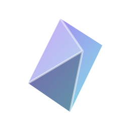

English | [Русский](README.ru.md)

<p align="center">
  
</p>

<h1 align="center">Shard</h1>
<p align="center">Your music. On your device.</p>

**Shard is a music player for Windows and Android with a shared Rust core.** Listen to local music, organize playlists, download tracks from YouTube or import them through Spotify and Yandex Music links, and transfer music between devices on your local network. Windows uses a native GPUI interface; Android uses Kotlin / Jetpack Compose and Media3. Neither client needs a browser engine.

## Features

- **Ignored tracks:** keep a track in your library and playlists while excluding it from the normal queue. Ignoring removes its favorite status and immediately skips it if it is playing. Direct playback remains available.
- **Artwork:** embedded tags, YouTube thumbnails and Spotify / Yandex Music metadata supply track and playlist covers. Fetch missing covers for an existing library without downloading audio again.
- **Connected devices:** a settings tab shows the current LAN pairing, device details, manual library transfer and progress. Android supports QR pairing with Windows, including phone or PC hotspots.
- **Favorites:** a built-in playlist with persistent favorite status shared across playlists. The ⋯ menu adds tracks to regular playlists.
- **Yandex Music:** import tracks, albums and public playlists by link. Public metadata supplies titles and artists; matching audio is downloaded from YouTube.
- **LAN synchronization:** enable Settings → Synchronization on two devices and paste one client's code into the other. Send a track or playlist, including Favorites, from its ⋯ menu, with progress on both clients. Android can scan the QR code or accept a pasted pairing code.
- **Your local library:** import audio files, manage the queue, shuffle, repeat, and edit track titles and artists.
- **YouTube downloads:** save a track or an entire playlist. Windows downloads MP3; Android preserves a suitable source codec.
- **Spotify links:** import tracks, albums, and public playlists. Shard reads public metadata, finds matching audio on YouTube, and preserves track names, artists, and order. No Spotify account or API key required.
- **Personal playlists:** edit names, choose covers and backgrounds, adjust blur, and pick a header color with compact sliders or HEX. An icon switches between ordered playback, shuffle and shuffle with autoplay without starting music.
- **Make it yours:** four themes and a Russian / English interface, switchable without restarting.
- **Everyday playback:** listening statistics and a library that survives restarts. Windows has tray and taskbar controls; Android supports background playback, notification and lock-screen controls, and Bluetooth headsets.
- **Collapsible Windows sidebar:** use the top button to show just the logo and playlist icons, with names on hover. The layout is remembered after restarting. A heart in the player bar lets you favorite the current track.

Spotify and Yandex Music supply metadata; the audio is downloaded from YouTube. Availability depends on public metadata and accessible YouTube videos. Failed tracks appear in the import report; completed downloads stay in your library. Download only content you have permission to save.

The desktop home page initially shows two rows of playlists, with a button to expand the rest. Playlist menus can merge two collections into a new playlist, preserving order and removing duplicate track IDs while keeping both originals.

On Windows, music links enter a sequential download queue. A sidebar progress card appears only while downloading; the queue and last 20 reports are also accessible through **Add music**. Stop the active download or remove waiting jobs. Stopping a job keeps imported tracks and proceeds to the next one. Downloads and reports last for the current app session. Playback and playlist customization remain available during downloads. Android persists download jobs separately; see the [Android guide](mobile/README.md).

On Windows, **Add music** has separate **Warn about duplicates** and **Ignore duplicates** settings. As with synchronization, warnings are on and ignoring is off by default: choose to download a copy or reuse an existing track, individually or for all detected matches. With warnings off, the selected policy applies automatically. Source URLs, title, artist and duration (within 3 seconds) are checked before downloading, including repeated entries within a collection. Incomplete metadata is checked again after downloading and before importing, including a file-content comparison. Skipping a duplicate adds the existing track to the new playlist without another audio copy; entries with missing audio files are not reused. Cancelling a review stops the current download, then the queue continues and already saved tracks remain. Download preferences are saved independently of synchronization preferences.

Artwork comes from embedded tags, Spotify / Yandex Music metadata and YouTube thumbnails. Imported albums automatically receive a playlist cover; adding a track can fill a missing playlist cover. Manual covers take priority. Fetch missing covers in **Settings → Storage** on Windows or **Settings → Appearance** on Android; the operation supports cancellation and does not download audio again. Windows also offers **Open storage folder**.

Spotify playlists and albums are fetched in pages, checking the complete item count. Tracks imported from a Spotify playlist use their own Spotify artwork, falling back to the matched YouTube thumbnail if it is missing or cannot be downloaded. The playlist cover represents only the collection. Album imports retain their album artwork for tracks. Previously saved artwork is not replaced automatically.

Windows artwork has two local versions: a normal cover (640 × 640 for new imports) and a 96 × 96 preview for track rows, the player and small playlist cards. Existing covers receive previews in the background without blocking library navigation. The decoded image cache is limited to 96 entries / 32 MiB and releases unused GPU image slots; the sidebar only creates visible playlist rows. These limits apply to the desktop image cache, not total application memory.

Choose **Ignore track** from a track's **⋯** menu or use the ban icon beside the playback timeline. Ignored tracks have a badge and remain in the library and playlists, but are excluded from the normal queue, shuffle, autoplay and repeats. An explicit direct play is allowed once. Ignoring clears Favorites; removing the ignore flag does not restore the favorite. **Settings → Ignoring** lets you play a track, unignore it, delete its stored audio, or delete all ignored tracks with confirmation.

On Windows, the mode icon in the collection header and player bar cycles through ordered playback, shuffle and shuffle with autoplay. Switching modes never starts music; new installations use ordered playback. In the third mode, reaching the end of a queue adds up to 20 random library tracks, preferring tracks absent from the current queue. Further passes avoid immediately repeating the current track. Repeat modes take priority; a single-track library stops when repeat is off. The mode survives restarts.

The Windows home page puts the top three tracks first, with ranking and subtle gradients. Listening totals use a compact strip, with an expandable weekly chart.

Windows storage controls are in **Settings → Storage**. To relocate the library, choose **Change storage** and select a parent folder. SHARD creates a new `SHARD` folder there, copies music, artwork, playlists and settings, verifies the database and restarts. An existing destination is never overwritten; the original library remains as a backup. Finish downloads and synchronization before moving. Paths set through `SHARD_DATA_DIR` / `LOZEX_DATA_DIR` must be changed through the environment variable instead.

**Clear storage** asks for confirmation, then removes tracks, their covers and transfer cache from the current library. Playlists remain empty, with their appearance, settings and listening totals preserved. External import sources and previous relocation backups are kept.

On desktop, **Settings → Audio** selects a specific audio output or the system default. The selection is saved, and switching preserves the track, position and pause state. If the selected device is lost, playback tries the system output; stalled audio streams are reopened automatically. With no output device, audio is still decoded at real-time speed and the queue continues; a reconnected device resumes at the current position. **Local playback** can be disabled while keeping the OBS stream running.

OBS has three capture options:

- **Application Audio Capture**: select Shard in OBS. This needs an active Windows endpoint, including HDMI or a virtual device.
- **Virtual cable**: select an already installed virtual output in Shard and its corresponding input in OBS. Drivers are installed separately.
- **Audio stream for OBS**: enable it in **Settings → Audio** and copy `http://127.0.0.1:17863/audio.wav`. Add an OBS **Media Source**, uncheck **Local File**, paste the URL, set **Input Format** to **wav**, and uncheck **Close file when inactive**. This works without any audio devices. Pausing or finishing the queue keeps the connection alive with silence. Restart the OBS source after restarting Shard if it does not reconnect automatically.

Shard volume applies to the OBS stream. Disable **Local playback** while retaining the desired player volume if only viewers should hear the audio. Use one capture method per scene to avoid duplicate sound. The stream is 48 kHz stereo 16-bit PCM, is available only on this computer, and accepts up to four clients. Each PCM queue is limited to 80 ms; slow clients cannot block playback. A busy port produces an error; disable the stream in another Shard instance before retrying.

**Settings → Customization → Backgrounds** and the playlist editor accept PNG/JPEG/WebP up to 25 MB, GIF and video (MP4, WebM, MKV, MOV, AVI, M4V) up to 250 MB. Animation loops silently and supports blur from 0–40. GIF and video require bundled FFmpeg or tools installed with `scripts/setup-youtube.ps1`. Frames are decoded sequentially with a bounded queue, up to 960 pixels on the longest side and 24 fps.

**Settings → Customization → Pets** offers a sleeping cat, nesting bird, dancing cats, a pixel frog and a piglet (sleeping and blinking). The frog has sleeping, blinking, breathing, dreaming, headphone, grooving and melancholy smoking loops. Dreaming has no sleep symbols; the melancholy frog has fading smoke and a softly glowing cigarette ember. Both the frog and cat offer pixel headphone and grooving variants with floating, fading notes instead of sleep symbols. All pets use a 64 × 48 pixel display area, about 25% smaller than before, without changing the controls or progress bar position. The eight selected frames use 96 KiB of pixel data; variant previews add at most 672 KiB while these settings are open. These are sprite budgets, not total application memory.

**Settings → Customization → Cursor** independently enables a kitten, frog or piglet that follows the pointer inside the app window. It lets clicks through, settles beside a stationary pointer, and pauses in an inactive window. The selected pet uses 216 KiB of sprite pixels for four directions (left, right, front and back). Speed is adjustable from 20% to 150%, defaulting to 50%; changing it preserves position and animation phase without changing the running frame rate. Movement follows window frames; settled pets schedule no updates.

Fullscreen playback retains the active app or playlist background, including animated media and blur, without starting a second decoder.

## Install

Choose an asset from [Releases](https://github.com/a99icted/Shard-music/releases):

| Platform | Version | Asset |
| --- | --- | --- |
| Windows 10 (2004+) / Windows 11, x64 | 0.1.10 | `Shard-0.1.10-Setup-x64.exe` |
| Android 8.0+, ARM64 phones | 0.1.8 | `Shard-Android-0.1.8-arm64-v8a.apk` |
| Android 8.0+, x86_64 devices / emulators | 0.1.8 | `Shard-Android-0.1.8-x86_64.apk` |

SHA-256 files accompany each installer / APK.

**Windows 10 (2004 or later) / Windows 11, x64.** The installer includes the player, yt-dlp, FFmpeg, ffprobe, Node.js, and the Visual C++ runtime. No separate Rust or Node.js installation is needed. Installation requires no administrator rights; uninstalling preserves your music and settings.

Android APKs are optimized release builds signed with the project's current development key for sideloading. Allow APK installation for your browser or file manager when prompted. Android has its own bundled download components; the Windows tools are not required. See the [Android guide](mobile/README.md) for setup and source builds.

## Quick start (Windows)

Search on Home and in the library uses an animated icon-only toggle: **folder** for the local library and **globe** for YouTube. Local search finds only tracks by title or artist. In Internet search, the filter icon inside the search field opens three checkboxes: Tracks, Albums and Playlists. Selected types constrain YouTube requests; changing filters refreshes results after 280 ms, and clearing all checkboxes stops search. YouTube suggestions are requested after 250 ms; matching cached completions appear immediately and HTTP connections are reused. Search uses YouTube Music directly, falling back to yt-dlp only when no tracks are found; choose a suggestion or press Enter / Search. Results include artwork and a Track, Album or Playlist badge, plus track duration and available YouTube play counts. ▶ streams audio in the player without importing an audio file. Playback preparation and buffering show animated indicators. Duration is resolved before playback; the timeline supports seeking and excludes buffering silence. Suggestions are cached for ten minutes and results for two minutes within the session. The circular + queues a download, a rotating indicator means queued or downloading, and ✓ marks a track already in your library. Downloads keep the results open. Expand albums and playlists to access individual tracks, Play all and Download all. Download all creates a separate collection in the playlist sidebar with the original name, artwork and track order; existing tracks are included according to the duplicate settings; the external link opens the original YouTube page. Online playback and downloads need yt-dlp and its bundled components, or the tools installed by `scripts/setup-youtube.ps1`.

1. Click **Add music** to select local files or paste a YouTube / Spotify / Yandex Music link.
2. Open a playlist, optionally choose a mode using its icon, and press **Listen**.
3. Use the **pencil** in the playlist header to edit its name and appearance. An empty name keeps the previous one. The **⋯** menu contains track selection and playlist deletion.
4. Open **Settings → Customization / Language** to change the theme, background, or interface language.
5. Mark tracks with the heart to collect them in **Favorites**. To send music to another Windows or Android device, open **Settings → Synchronization** on both devices and pair them with a connection code or the Android QR scanner. Send a track or playlist from its **⋯** menu, or use **Synchronize all tracks** in settings or the library.

The window close button hides Shard in the tray and keeps music playing. Choose **Exit** from the tray menu to quit. Launching Shard again brings the existing window forward.

Music and settings default to `%LOCALAPPDATA%\Shard\Shard\data`. Settings shows the current path and lets you relocate storage. Removing a playlist leaves its tracks in your library.

LAN synchronization sends a track, playlist or the entire library. Collection
transfers open duplicate options: warnings default to on, and **Ignore duplicates**
defaults to off. Skip/reuse matches or send additional copies, individually or for
all matches. Sending a growing playlist again adds its new tracks. Retry an
interrupted transfer to resume from the saved position, including after an app
restart. Ignore flags, deletions, external cover files, backgrounds, statistics and settings are not transferred. Embedded covers travel with the audio file. Favorites are added on receipt; removals are not mirrored. Devices
must reconnect after synchronization restarts, and both clients must support
protocol version 2. See [docs/LAN_SYNC.md](docs/LAN_SYNC.md) for details and limits.

**Live synchronization is not implemented in these builds.** Remote playback, automatic action / flag synchronization, phantom tracks and per-device statistics remain a [shared Windows / Android design](docs/LIVE_SYNC_DESIGN.ru.md), with [acceptance scenarios](docs/LIVE_SYNC_ACCEPTANCE.md). The Connected devices tab currently shows one pairing for the active session; it does not represent a persistent online device list.

## Build from source

Requires [Rust stable](https://rustup.rs/) with the MSVC toolchain and [Visual Studio Build Tools](https://visualstudio.microsoft.com/visual-cpp-build-tools/) with **Desktop development with C++** and **Windows SDK**. For downloads, install [Node.js LTS](https://nodejs.org/) or [Deno](https://deno.com/).

```powershell
.\scripts\setup-youtube.ps1
cargo run --locked
```

The setup script downloads yt-dlp, FFmpeg, and ffprobe into `tools` and verifies their SHA-256 checksums. Local playback works without these tools. Keep `vendor/gpui` in the checkout: it contains the GPUI fixes used by Shard. Quit the development build through its tray menu before rebuilding.

```powershell
cargo test --locked --all-targets
.\scripts\package-windows.ps1
.\scripts\verify-windows-package.ps1
```

The packaging script builds the release and writes the installer, SHA-256 checksum, and payload manifest to `dist`. On first use, it downloads verified Node.js and Inno Setup packages. The MSVC redistributable CRT must be available in Visual Studio Build Tools; use `-RuntimeDirectory` to specify its directory. `-SkipBuild` reuses `target/release/shard.exe`.

The verification script checks the current staged payload, manifest, executable versions, architecture and installer checksum. It requires the packaging staging files and does not install over your existing copy.

Android build instructions are in [mobile/README.md](mobile/README.md). Shared Rust tests can run without desktop dependencies using `cargo test --locked --no-default-features --lib --test library -- --test-threads=1`.

Keep build output, downloaded tools, caches and personal libraries out of commits. See [CHANGELOG.md](CHANGELOG.md) for release history and [the port validation report](docs/PORT_VALIDATION.ru.md) for the current build results and test limits.

## Support Shard

If you'd like to support Shard's development, you can donate to one of these wallets:

| Coin / network | Wallet address |
| --- | --- |
| GRAM (TON) | `UQDhOStCTVs8CYld6vAJi_wEbaAdzudKKmodxW68oy7R1K81` |
| ETH (ETH) | `0xa0206Dc84e56b49480319CdC6A6A9c983747d4BC` |
| BTC (BTC) | `bc1qzlnzamh2krcsdfgjwfnmz8xst65vzuxyawjcc8` |
| SOL (SOL) | `6oFWiDemRLD5NsvfFr1fdEWAjYQJmuhDKUnWEfdnqAjs` |

## License

[MIT](LICENSE). Third-party components and their licenses are listed in [THIRD_PARTY_NOTICES.md](THIRD_PARTY_NOTICES.md).
