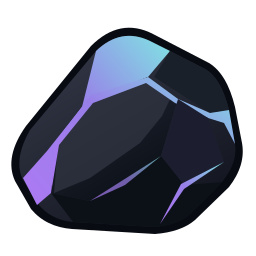

English | [Русский](README.ru.md)

<p align="center">
  
</p>

<h1 align="center">Shard</h1>
<p align="center">Your music. On your device.</p>

**Shard is a lightweight music player for Windows, written in Rust.** Listen to local music, organize playlists, and download tracks from YouTube or import them through Spotify links. A native GPUI interface keeps the player lean, without a browser engine or gigabytes of RAM overhead.

## Features

- **Your local library:** import audio files, manage the queue, shuffle, repeat, and edit track titles and artists.
- **YouTube downloads:** save a track or an entire playlist as MP3.
- **Spotify links:** import tracks, albums, and public playlists. Shard reads public metadata, finds matching audio on YouTube, and preserves track names, artists, and order. No Spotify account or API key required.
- **Personal playlists:** edit names, choose covers and backgrounds, adjust blur, and pick a header color with compact sliders or HEX. Shuffle starts playback immediately.
- **Make it yours:** four themes and a Russian / English interface, switchable without restarting.
- **Everyday playback:** system tray, Windows taskbar controls, listening statistics, and a library that survives restarts.

Spotify supplies metadata; the audio is downloaded from YouTube. Availability depends on public Spotify data and accessible YouTube videos. Failed tracks appear in the import report; completed downloads stay in your library. Download only content you have permission to save.

## Install

Download **`Shard-0.1.2-Setup-x64.exe`** from [Releases](https://github.com/a99icted/Shard-music/releases).

**Windows 10 (2004 or later) / Windows 11, x64.** The installer includes the player, yt-dlp, FFmpeg, ffprobe, Node.js, and the Visual C++ runtime. No separate Rust or Node.js installation is needed. Installation requires no administrator rights; uninstalling preserves your music and settings.

## Quick start

1. Click **Add music** to select local files or paste a YouTube / Spotify link.
2. Open a playlist and press **Listen** or **Shuffle** to start playback.
3. Use the **pencil** in the playlist header to edit its name and appearance. An empty name keeps the previous one. The **⋯** menu contains track selection and playlist deletion.
4. Open **Settings → Customization / Language** to change the theme, background, or interface language.

The window close button hides Shard in the tray and keeps music playing. Choose **Exit** from the tray menu to quit. Launching Shard again brings the existing window forward.

Music and settings are stored in `%LOCALAPPDATA%\Shard\Shard\data`. Removing a playlist leaves its tracks in your library.

## Build from source

Requires [Rust stable](https://rustup.rs/) with the MSVC toolchain and [Visual Studio Build Tools](https://visualstudio.microsoft.com/visual-cpp-build-tools/) with **Desktop development with C++** and **Windows SDK**. For downloads, install [Node.js LTS](https://nodejs.org/) or [Deno](https://deno.com/).

```powershell
.\scripts\setup-youtube.ps1
cargo run --locked
```

The setup script downloads yt-dlp, FFmpeg, and ffprobe into `tools` and verifies their SHA-256 checksums. Local playback works without these tools. Keep `vendor/gpui` in the checkout: it contains the GPUI fixes used by Shard. Quit the development build through its tray menu before rebuilding.

```powershell
cargo test --locked --all-targets
.\scripts\package-windows.ps1
```

The packaging script builds the release and writes the installer, SHA-256 checksum, and payload manifest to `dist`. On first use, it downloads verified Node.js and Inno Setup packages. The MSVC redistributable CRT must be available in Visual Studio Build Tools; use `-RuntimeDirectory` to specify its directory. `-SkipBuild` reuses `target/release/shard.exe`.

Build output, downloaded tools, caches, and personal libraries are excluded from Git. See [CHANGELOG.md](CHANGELOG.md) for release history.

## Support Shard

If you'd like to support Shard's development, you can donate to one of these wallets:

| Coin / network | Wallet address |
| --- | --- |
| GRAM (TON) | `UQDhOStCTVs8CYld6vAJi_wEbaAdzudKKmodxW68oy7R1K81` |
| ETH (ETH) | `0xa0206Dc84e56b49480319CdC6A6A9c983747d4BC` |
| BTC (BTC) | `bc1qzlnzamh2krcsdfgjwfnmz8xst65vzuxyawjcc8` |
| SOL (SOL) | `6oFWiDemRLD5NsvfFr1fdEWAjYQJmuhDKUnWEfdnqAjs` |

## License

[MIT](LICENSE). Third-party components and their licenses are listed in [THIRD_PARTY_NOTICES.md](THIRD_PARTY_NOTICES.md).
