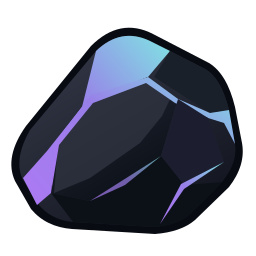

[English](README.md) | Русский

<p align="center">
  
</p>

<h1 align="center">Shard</h1>
<p align="center">Ваша музыка. На вашем устройстве.</p>

**Shard — лёгкий музыкальный плеер для Windows, написанный на Rust.** Слушайте локальную музыку, собирайте плейлисты и скачивайте треки с YouTube или по ссылкам Spotify. Нативный интерфейс на GPUI работает без браузерного движка и не требует гигабайтов оперативной памяти для обычного прослушивания.

## Возможности

- **Локальная библиотека:** импорт аудиофайлов, очередь, перемешивание, повтор и редактирование названий треков и исполнителей.
- **Загрузка с YouTube:** сохранение отдельного трека или целого плейлиста в MP3.
- **Ссылки Spotify:** импорт треков, альбомов и открытых плейлистов. Shard читает публичные метаданные, находит аудио на YouTube и сохраняет названия, исполнителей и порядок треков. Аккаунт Spotify и API-ключ не нужны.
- **Свои плейлисты:** название, обложка, фон, размытие и цвет шапки с компактными ползунками или вводом HEX. «Перемешать» сразу запускает воспроизведение.
- **Оформление и язык:** четыре темы и переключение между русским и английским без перезапуска.
- **Удобное прослушивание:** системный трей, управление с панели задач Windows, статистика и сохранение библиотеки после перезапуска.

Spotify используется для получения метаданных, аудио скачивается с YouTube. Доступность зависит от публичных данных Spotify и доступных видео YouTube. Ошибки отдельных треков появляются в отчёте; уже загруженная музыка остаётся в библиотеке. Скачивайте только контент, на сохранение которого у вас есть разрешение.

## Установка

Скачайте **`Shard-0.1.2-Setup-x64.exe`** в разделе [Releases](https://github.com/a99icted/Shard-music/releases).

**Windows 10 (2004 и новее) / Windows 11, x64.** Установщик содержит плеер, yt-dlp, FFmpeg, ffprobe, Node.js и библиотеки Visual C++. Отдельно устанавливать Rust или Node.js не нужно. Установка выполняется без прав администратора; удаление приложения сохраняет музыку и настройки.

## Быстрый старт

1. Нажмите **«Добавить музыку»**, выберите локальные файлы или вставьте ссылку YouTube / Spotify.
2. Откройте плейлист и нажмите **«Слушать»** или **«Перемешать»**.
3. Нажмите **карандаш** в шапке плейлиста, чтобы изменить название и оформление. Пустое поле сохраняет прежнее название. В меню **⋯** находятся выбор треков и удаление плейлиста.
4. Откройте **«Настройки → Кастомизация / Язык»**, чтобы сменить тему, фон или язык интерфейса.

Крестик окна скрывает Shard в трей и сохраняет воспроизведение. Для полного завершения выберите **«Выйти»** в меню трея. Повторный запуск возвращает уже открытое окно.

Музыка и настройки хранятся в `%LOCALAPPDATA%\Shard\Shard\data`. Удаление плейлиста не удаляет его треки из библиотеки.

## Сборка из исходников

Нужны [Rust stable](https://rustup.rs/) с MSVC toolchain и [Visual Studio Build Tools](https://visualstudio.microsoft.com/visual-cpp-build-tools/) с компонентами **Desktop development with C++** и **Windows SDK**. Для загрузки музыки установите [Node.js LTS](https://nodejs.org/) или [Deno](https://deno.com/).

```powershell
.\scripts\setup-youtube.ps1
cargo run --locked
```

Скрипт скачивает yt-dlp, FFmpeg и ffprobe в `tools` и проверяет SHA-256. Локальное воспроизведение работает без этих компонентов. Сохраните в исходниках каталог `vendor/gpui`: он содержит используемые Shard исправления GPUI. Перед пересборкой завершите запущенную сборку через меню трея.

```powershell
cargo test --locked --all-targets
.\scripts\package-windows.ps1
```

Скрипт упаковки собирает релиз и сохраняет установщик, контрольную сумму SHA-256 и манифест файлов в `dist`. При первом запуске он скачивает проверенные пакеты Node.js и Inno Setup. Для библиотеки MSVC нужен компонент Redistributable CRT в Visual Studio Build Tools; путь можно задать параметром `-RuntimeDirectory`. Параметр `-SkipBuild` использует готовый `target/release/shard.exe`.

Сборки, скачанные инструменты, кеши и личная библиотека исключены из Git. История версий — в [CHANGELOG.md](CHANGELOG.md).

## Поддержать Shard

Если хотите поддержать разработку Shard, можно отправить пожертвование на один из кошельков:

| Монета / сеть | Адрес кошелька |
| --- | --- |
| GRAM (TON) | `UQDhOStCTVs8CYld6vAJi_wEbaAdzudKKmodxW68oy7R1K81` |
| ETH (ETH) | `0xa0206Dc84e56b49480319CdC6A6A9c983747d4BC` |
| BTC (BTC) | `bc1qzlnzamh2krcsdfgjwfnmz8xst65vzuxyawjcc8` |
| SOL (SOL) | `6oFWiDemRLD5NsvfFr1fdEWAjYQJmuhDKUnWEfdnqAjs` |

## Лицензия

[MIT](LICENSE). Сторонние компоненты и их лицензии перечислены в [THIRD_PARTY_NOTICES.md](THIRD_PARTY_NOTICES.md).
