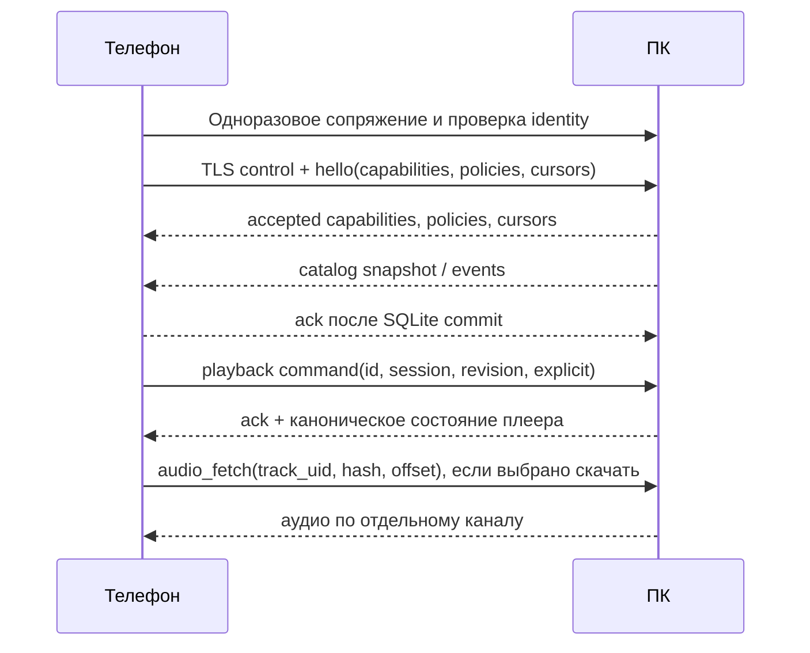

# Live-синхронизация Shard: проект для ПК и Android

Дата: 22 ноября 2026. Статус: проект поведения и общего протокола; live-функции
ниже ещё не реализованы. Реализованный первый шаг указан в разделе 1.
Документ задаёт общий контракт для обеих платформ, чтобы мобильный клиент
не получил другую трактовку режимов, удаления, игнора или статистики.

## 1. Что есть сейчас и что добавлено первым шагом

Текущая реализация: `src/sync.rs`, `src/sync/transfer.rs`,
`src/ui/synchronization.rs`; протокол v2 описан в [LAN_SYNC.md](LAN_SYNC.md).

- Ручная передача трека, плейлиста или библиотеки; один peer за сеанс.
- Возобновление файлов, SHA-256, поиск дубликатов, квитанции повторных операций.
- Стабильный UUID устройства есть в preferences, доверие между запусками не сохраняется.
- Удаления не передаются; избранное передаётся аддитивно; игнор и статистика не передаются.
- TCP-соединение обслуживает запрос, постоянного control-канала и heartbeat нет.
- Передача не зашифрована. UUID устройства не является криптографическим доказательством личности.

Первый реализованный шаг: **Настройки → Подключённые устройства**. Вкладка
появляется при включённой синхронизации. Показывает настоящее сопряжение:
имя, UUID, адрес без секрета подключения, версию протокола, ручную передачу
всей библиотеки и её прогресс. Есть пустое состояние и переход к подключению.
Статус называется «Сопряжено в текущем сеансе»: v2 не позволяет честно
показывать постоянный «онлайн». Выключение синхронизации очищает локальный список.
Это список одного сопряжения, а не уже готовый менеджер нескольких live-устройств.

Исходники Android восстановлены из `codex/android-app` в `mobile/` и подключены
к тому же `shard` через `src/mobile.rs`. В Android перенесены список игнора,
правила очереди, кнопка запрета в плеере, обложки и вкладка сопряжённого устройства.
Исправления QR/точек доступа объединены в общем v2-протоколе. Live-функции v3
из следующих разделов остаются проектом; мобильный интерфейс не показывает
неработающие тумблеры. Результаты текущих проверок фиксируются в
[PORT_VALIDATION.ru.md](PORT_VALIDATION.ru.md).

## 2. Решения и границы

Предлагается локальная сеть без обязательного облака, аккаунта или постоянно
работающего внешнего сервера. «Сервер» в интерфейсе — **выбранное устройство
воспроизведения / ведущий сеанса**, например ПК. Роль закрепляется явно, а не
вычисляется заново по тому, кто первым открыл TCP-сокет. Телефон тоже может
стать ведущим, если платформа и настройки разрешают.

Разделить четыре независимых механизма:

1. **Управление воспроизведением**: команды и состояние плеера, живут только в сеансе.
2. **Изменения библиотеки**: долговечный журнал добавлений, правок, плейлистов и флагов.
3. **Доступность аудио**: какие файлы есть на каком устройстве, скачивание по запросу.
4. **Прослушивания**: события статистики с происхождением и устранением дублей.

Большая загрузка аудио не должна задерживать паузу или перемотку. Нельзя
синхронизировать SQLite-файл целиком: локальные ID и пути различаются, а запись
идёт одновременно с прослушиванием. Одной базы на устройство достаточно;
профили других устройств — строки с `device_id`, а не отдельные копии всей БД.

## 3. Три режима воспроизведения

Главный тумблер **Live-режим** включён отдельно от ручной синхронизации.
Внутри — переключатель **Где воспроизводить**:

| Значение wire / подпись | Запуск с телефона | Запуск с ПК | Звук и управление |
| --- | --- | --- | --- |
| `off` / «Не связывать воспроизведение» | Только телефон | Только ПК | Независимые плееры; обмен библиотекой может работать |
| `host_only` / «На ведущем устройстве: <имя>» | Играет выбранный ПК | Играет выбранный ПК | Телефон — пульт; его нижняя панель отражает ПК |
| `all` / «Все — на другом устройстве» | Играет только ПК | Играет только телефон | Управление доступно с обеих сторон; явный запуск направляется другому устройству |

**Принятое поведение «Все»: играет только другое устройство.** Для пары
телефон ↔ ПК запуск с телефона включает звук на ПК, запуск с ПК — на телефоне.
Инициатор запуска не воспроизводит этот трек локально. В интерфейсе рядом с
«Все» обязательно пояснение «Запускать на другом устройстве», чтобы подпись
не воспринималась как одновременный звук на обоих устройствах.

Не смешивать три состояния: **кто отправляет команду**, **кто упорядочивает
команды** и **кто выводит звук**. В `host_only` ПК может быть всем сразу,
телефон — только источником команды. В `all` активное устройство вывода одно:
оно меняется при явном запуске с другой стороны, а ведущий порядка остаётся
тем же. Локальная громкость по умолчанию у каждого своя.

При включении live открывается выбор ведущего и участников, локальные плееры
не начинают играть сами. Добавление участника не включает на нём звук.
При смене ведущего — новый `session_id`.
При потере ведущего не выбирать нового автоматически и не возобновлять
старые команды: показать «Ведущее устройство недоступно»; пользователь может
остаться на локальном воспроизведении или создать новый сеанс.

При отключении live локально начатая музыка продолжает играть независимо;
пульт перестаёт показывать чужой плеер. Текущее устройство вывода `all` с уже
доступным аудио может продолжить локально, но не выполняет недоставленные
сетевые команды. На инициаторе звук автоматически не включается.

### Команды и защита от циклов

Команда содержит `command_id`, `session_id`, `origin_device_id`,
`target_device_ids`, `expected_revision`, `expires_at`, тип и payload.
Ведущий принимает команды последовательно, присваивает `playback_revision`
и возвращает ack с каноническим состоянием. Повтор того же `command_id`
возвращает прежний результат, а не повторяет «следующий трек».

- Передавать `play`, `pause`, `seek_to`, `next`, `previous`, `set_queue`,
  `set_repeat`, `set_shuffle`; не передавать неоднозначный `toggle`.
- Полученная команда помечается remote и не порождает новую исходящую команду.
- При гонке двух команд ведущий задаёт порядок; неверная revision даёт
  `stale_revision` и актуальный snapshot, клиент решает заново на новом состоянии.
- Снимки состояния содержат revision, track UUID, порядок очереди, позицию,
  paused и точку времени ведущего. Наблюдение позиции не является командой seek.
- Команды управления не переживают разрыв соединения: короткий TTL, проверки
  session/revision при reconnect. Пауза вчерашнего сеанса не исполняется сегодня.
- Автоматическая очередь везде исключает игнор. Прямой `play` игнорируемого
  трека передаёт `explicit: true`; добавление текущего трека в игнор пропускает
  его сразу на соответствующих устройствах сеанса.

### «Все»: маршрутизация запуска и смена устройства вывода

Маршрутизация определяется источником **явного пользовательского запуска**.
Получение команды на ПК не является новым запуском «с ПК»: иначе команда
будет бесконечно возвращаться между устройствами. Snapshot состояния,
автоматический переход очереди и repeat также не меняют устройство вывода.

Пауза, продолжение, перемотка, next/previous и изменение очереди управляют
текущим устройством вывода независимо от того, откуда пришла команда.
Новый явный выбор трека на ПК направляется телефону, а новый выбор на
телефоне — ПК. Нижняя панель явно показывает «Играет на: <имя>».

При смене устройства сначала подготовить аудио на новом получателе, затем
получить подтверждение остановки прежнего устройства и только после этого
разрешить запуск на новом. Устройство-инициатор также должно остановить своё
воспроизведение перед запуском на peer. Команды и ack привязаны к session/revision;
дубликат команды не начинает второй переход. Это обеспечивает один активный
вывод в сеансе. При неизвестном результате остановки или недоступном получателе
показать ошибку/состояние ожидания и не запускать локальный fallback автоматически.

Если аудио на получателе отсутствует, показать «Подготовка трека» и получить
его у разрешённого источника. Подготовка ограничена тайм-аутом и отменяется
при более новой команде запуска. Синхронизация аудиочасов и multiroom не нужны
для принятого поведения `all`.

## 4. Интерфейс подключённых устройств

Вкладка видна, пока включена синхронизация; история доверенных устройств
в дальнейшем хранится при выключении, но соединения закрываются.

Вкладка содержит:

- Это устройство: имя, тип, собственный профиль статистики.
- Карточки устройств: имя/тип, `online`, `connecting`, `offline`,
  `incompatible`, последнее подтверждённое присутствие и состояние передачи.
- Роль в live-сеансе и выбор устройства вывода. Адрес — дополнительная информация.
- «Подключить», «Переименовать у себя», «Отключить», «Забыть устройство».
  Отключить разрывает сеанс, забыть отзывает доверие; это разные действия.
- Настройки обмена **для этого устройства**, очередь скачивания и «Каталог устройства».
- «Учитывать в моей статистике» — локальный фильтр, не команда удаления истории.

Показывать online только по аутентифицированному heartbeat/control-соединению,
а не по записи в БД или последнему успешному копированию. Предложение для
активного сеанса: heartbeat 5 секунд, offline после 3 пропусков; значения
уточнить по Android battery/background тестам. Нет активного сеанса — backoff
и обнаружение вместо постоянного частого опроса.

«Все» разрешает управление воспроизведением с обеих сторон текущего подключения.
Для пары получатель — другой участник. Если устройств больше двух, пользователь
явно выбирает удалённое устройство вывода; локальное устройство нельзя выбрать
как получателя собственного запуска в этом режиме. Рассылки звука сразу всем
peer нет. Подключение нового устройства не включает на нём звук, удаление
файлов или выгрузку всей библиотеки автоматически.

## 5. Тумблеры и права на обмен

Глобальные значения служат шаблоном новых подключений. У карточки устройства
есть переопределения и видимое итоговое направление «Отправлять / Принимать».

| Настройка | Значение по умолчанию | Точное действие |
| --- | --- | --- |
| Live-режим | Выкл. | Открывает постоянный сеанс и его настройки |
| Где воспроизводить | Не связывать | Три режима из раздела 3 |
| Показывать фантомы / каталог устройства | Выкл. | Обмен метаданными и доступностью, без аудио |
| Синхронизировать все треки | Выкл. | Каталог + фоновая загрузка отсутствующего аудио и новых треков |
| Синхронизировать действия | Выкл. | Главный переключатель изменений библиотеки; раскрывает категории ниже |
| Добавления и изменения треков | Вкл. внутри действий | Добавление записи, название/исполнитель, обложка по запросу |
| Плейлисты | Вкл. внутри действий | Создание, название, состав и порядок |
| Удаления | Выкл., отдельное включение | Логическое удаление трека/плейлиста, не просто очистка кеша |
| Флаги: избранное | Выкл. | Обе стороны отметки: добавить и снять |
| Флаги: игнор | Выкл. | Добавить и снять игнор, включая правило избранного |
| Статистика | Выкл. | Передача событий прослушивания с происхождением |
| Учитывать устройство в статистике | Вкл. после явного выбора источника | Только фильтр сводки на этом устройстве |

Флаги и статистику разрешается включать независимо от обмена действиями.
«Синхронизировать все действия» в расширенном наборе — явная команда включить
все категории, включая флаги и удаления; перед применением показать состав.
Формулировка «все» не должна скрыто оставлять включённые категории выключенными
или включать статистику/загрузку всех файлов: это другие механизмы.

Политики принимаются обеими сторонами. Эффективное A→B:
`A.allow_send(category, B) && B.allow_receive(category, A)`.
Отправитель не может своим тумблером разрешить удаление на получателе.
Изменение политики имеет revision и действует после подтверждения peer.

«Все треки» требует обмена метаданными; UI объясняет зависимость и включает
каталог. Каталог сам по себе не включает загрузки. Флагу для неизвестного трека
хватает минимального stub UUID/названия, но это не разрешение получать весь каталог.
Удаления требуют действий, а статистика не требует локального аудиофайла.

Отключённая категория не означает «на другой стороне всё удалено». При включении
категории предлагать первоначальный merge со сводкой. Старые удаления, накопленные
до выдачи разрешения, не применять внезапно. Snapshot с текущими разрешёнными
значениями служит baseline; дальше передаются события. Изменения политики
не должны застревать за вечным повтором запрещённых событий.

Дополнительно для аудио: Wi-Fi/разрешённая сеть, лимит хранения, свободное место,
приоритет ручных загрузок, пауза/отмена и resume. Эти ограничения нужны до
автоматического копирования большой библиотеки на телефон.

## 6. Фантомы треков

Рекомендуемая подпись в пользовательском UI: **«Треки с других устройств»**;
в настройках можно пояснить «метаданные без скачивания (фантомы)».
Фантом — известная композиция без локального аудио. Нельзя подставлять пустой
`file_path` в существующий `Track`: текущий сервис трактует запись как локальный файл.

| Доступность | Плашка | Действие |
| --- | --- | --- |
| Аудио есть здесь | «На устройстве» | Обычное воспроизведение |
| Аудио только у online-peer | «На <имя>» | «Скачать» или «Включить на <имя>» |
| Все источники offline | «Источник недоступен» | Метаданные доступны, запуск показывает причину |
| Кешируется/скачивается | «Скачивается…» | Прогресс, отмена, resume |

В каталоге доступны фильтры «Здесь», «На других устройствах», «Везде».
Один трек с доступностью у трёх peer — одна карточка с тремя источниками.
При настоящих дублях/разных версиях не объединять только по названию.
Разрешить добавлять фантом в плейлист: принадлежность не требует аудио.
Исчезновение peer не удаляет его фантомы; помечает каталог устаревшим.

Для MVP локальное прослушивание фантома сначала скачивает и проверяет файл,
затем запускает его; «Включить на устройстве» не скачивает его сюда. Прогрессивный
streaming с range/seek — отдельная capability. Не выдавать загрузку целиком
за готовый streaming. Запрос аудио направлять только peer, который объявил файл
и разрешил его выдачу; SHA-256 проверять после загрузки.

## 7. Идентичность, события и конфликты

Локальный SQLite `tracks.id` остаётся внутренним ключом. Для обмена:

- `device_id` — стабильный UUID, плюс привязанная криптографическая identity.
- `track_uid`, `playlist_uid` — UUID сущностей, независимые от локального rowid.
- `blob_hash` — SHA-256 конкретного аудио, а не идентичность композиции.
- Явное копирование создаёт новый `track_uid`, даже если байты те же.
- Происхождение `(source_device, source_id)` и таблица alias сохраняют связь
  существующего v2-переноса с новой сущностью. Хеш позволяет предложить reuse;
  метаданные сами по себе не дают права слить две сущности.

Все локальные мутации проходят через общий domain-service. Одна SQLite-транзакция
записывает изменение и событие outbox. Импорт remote-события применяет изменение
и сохраняет receipt, не создавая новое локальное событие с новым ID.
Один исходный event можно ретранслировать с тем же ID только в явно общей группе;
по умолчанию обмен разрешён паре, без транзитивной раздачи третьим устройствам.

Envelope долговечного события:

```json
{
  "event_id": "uuid",
  "group_id": "uuid",
  "origin_device_id": "uuid",
  "origin_seq": 42,
  "lamport": 105,
  "entity_kind": "track",
  "entity_uid": "uuid",
  "entity_generation": 1,
  "kind": "flags.set",
  "payload": { "favorite": false, "ignored": true }
}
```

`origin_seq` монотонен у источника; `(origin_device_id, origin_seq)` и `event_id`
уникальны. Dedup, ack и cursor — по каждому источнику/политике, не один общий
timestamp. Время стены используется для отображения, не как единственный порядок.
Lamport увеличивается на получении и локальной записи. Для одинакового поля
конкурирующие изменения сравниваются по `(lamport, origin_device_id, event_id)`;
все стороны получают одинаковый результат даже при неверных часах.

Правила:

- Название/исполнитель/имя плейлиста — отдельные регистры с таким порядком.
  Правка названия не затирает независимую правку исполнителя.
- Состав плейлиста — add/remove с тегами добавления (наблюдаемое удаление).
  Удаляется известное добавление; независимое новое добавление сохраняется.
- Для MVP порядок плейлиста — единый versioned-список UID: конкурентный reorder
  выбирается детерминированно; новые независимые memberships не теряются и
  добавляются в хвост с детерминированным порядком. Позже возможно sequence CRDT.
- `favorite` и `ignored` имеют общий versioned `flags`-агрегат, чтобы устаревшее
  «любимое» не воскресло поверх нового «игнор». В wire есть маска разрешённых
  полей; получатель меняет только разрешённые флаги и затем применяет инварианты.
- **Добавление в игнор всегда снимает избранное атомарно.** Это действует и на
  remote-игнор; если обмен избранным отключён, снятие всё равно является следствием
  локального правила игнора. Это должно быть написано рядом с тумблером игнора.
  Снятие игнора не возвращает избранное. Предложение для обратного действия:
  сердечко у игнорируемого трека предлагает сначала снять игнор, без скрытой смены.
- Полученный флаг игнора текущего трека переключает плеер после commit;
  повтор event не переключает следующий трек повторно.
- Удаление сущности — tombstone с generation. Нельзя воскресить старым add,
  запоздалым snapshot или replay; восстановление — отдельное действие с новой
  generation/новым UUID. Старые события относятся к прежней generation.
- Конкурентное изменение уже удалённой сущности не восстанавливает её;
  хранится как конфликт для диагностики/восстановления.

Не удалять tombstone просто через N дней, пока offline-устройство может прислать
старую копию. Сборка мусора — после ack всех действующих участников группы;
забытое/долго отсутствовавшее устройство возвращается через новый snapshot epoch.

## 8. Семантика удаления

Нужны отдельные команды в UI и wire:

1. **«Освободить место на этом устройстве»** — удалить локальный blob/кеш,
   сохранить карточку, флаги, плейлисты и статистику. Сетевое событие меняет
   доступность, не удаляет музыку на другом устройстве.
2. **«Удалить из библиотеки»** — логический tombstone, локальные memberships
   убираются; распространение только при разрешённой категории удалений.
3. **«Удалить с подключённых устройств»** — явная операция с перечислением
   получателей и подтверждением; отсутствие прав показывается до запуска.
4. Удаление плейлиста удаляет подборку, а не её аудиотреки.
5. **«Удалить все игнорируемые»** и **«Очистить хранилище»** — массовые операции
   со сводкой локальных/удалённых последствий; прежнюю кнопку нельзя незаметно
   превратить в удаление музыки на всех устройствах.

Автоматическое зеркало аудио не должно скачивать обратно намеренно освобождённый
локальный файл: нужен `local_download_override = excluded` до явной отмены
или нового выбора «Скачать сюда». Нельзя вывести удаление из отсутствия файла
в каталоге: это может быть offline, частичный snapshot или выключенная политика.

## 9. Статистика по устройствам

Профиль устройства — источник истории, не новый пользователь и не отдельная БД.
Текущие `listening_days` и `listening_sessions` не хранят источник; прибавлять
их totals при каждом sync нельзя — получатся повторные часы и прослушивания.

Переход к событиям/сегментам:

- Ключ: `(renderer_device_id, listen_session_id, segment_seq)`.
- Поля: `track_uid`, snapshot названия/исполнителя/длительности, начало UTC,
  timezone offset на момент записи, фактически услышанные ms, revision,
  необязательные `live_session_id` и `playback_intent_id` явного запуска.
- Источник — устройство, реально выводившее звук. Телефон-пульт не записывает
  прослушивание ПК как собственное. Пауза/seek не создают услышанные миллисекунды.
- Фиксированные завершённые сегменты append-only; replay делает UPSERT/dedup,
  а не `total += remote_total`. Если передавать текущий сегмент, только монотонную
  абсолютную величину с revision, никогда повторяемый инкремент.
- Статистика сохраняется после удаления трека через UID/metadata snapshot.
- При `all` статистику пишет только выбранное удалённое устройство вывода.
  Инициатор-пульт не создаёт копию прослушивания. При смене получателя прежний
  renderer закрывает свой сегмент, новый открывает свой; учитывается фактическое
  время каждого устройства без повторного прибавления того же события. Независимые
  локальные сеансы не сливаются по совпавшему треку.
- «Учитывать ПК / телефон / …» — локальный фильтр запросов и графиков; выключение
  не стирает историю и не рассылает удаление статистики другим устройствам.
- Статистику принимать/отправлять можно отдельно. При выключении не передавать
  новые события; при повторном включении спросить о догрузке накопленной истории.

Миграция старой истории: существующий итог закрепить за профилем этого устройства
как legacy, без выдумывания временных сегментов. Legacy rollup получает стабильный
ключ, переносится максимум один раз и показывается отдельно от точной событийной
истории; пересечение двух независимых старых баз автоматически не угадывать.
Границы дня/недели считать по выбранной пользователем timezone сводки; сохранённый
offset нужен для исходного отображения и корректной интерпретации старых данных.

## 10. Новые таблицы и миграции

Это проект схемы, не выполненная миграция. Нужны versioned migrations с backup
и проверкой открытия старых библиотек на обеих платформах.

| Таблица | Главный ключ / назначение |
| --- | --- |
| `devices` | `device_id`; имя, платформа, public-key fingerprint, trust/revocation, last_seen |
| `peer_policies` | `peer_id`; send/receive по категориям, revision, лимиты загрузки |
| `sync_groups` / `sync_group_members` | Явные границы обмена/ретрансляции, не случайный mesh |
| `track_identity` / `playlist_identity` | local rowid ↔ global UID/generation |
| `entity_aliases` | v2 origin/source ID ↔ UID, подтверждённые соответствия |
| `catalog_tracks` | Глобальная metadata-карточка, допускает отсутствие local rowid |
| `track_replicas` | `(track_uid, device_id, blob_hash)`; availability и metadata revision |
| `local_audio` | UID/blob ↔ безопасный локальный путь; pinned/cache/download override |
| `sync_events` | ID, origin seq, lamport, kind, entity/generation, payload; outbox/история |
| `sync_receipts_v3` / `sync_cursors` | Дедуп, курсоры по origin и policy epoch, ack после commit |
| `entity_tombstones` | UID/generation, delete event и ack-граница для GC |
| `playlist_membership_tags` | OR-set добавления/удаления memberships |
| `entity_field_versions` | Версии metadata, flags-агрегата и порядка плейлиста |
| `listen_segments` | Идемпотентные сегменты по renderer/session/seq |
| `statistics_sources` | Локальный include/exclude устройства в сводках |
| `statistics_legacy` | Прежние rollups с provenance и стабильным migration ID |

Секреты устройства хранить отдельно от синхронизируемых таблиц (Android Keystore,
Windows защищённое хранилище). `last_seen` не переносить как remote-факт online.
Не ставить CASCADE от удаления доверенного устройства на его историю прослушивания.

## 11. Транспорт и совместимость v3

Рекомендуется один аутентифицированный **control-канал** для событий, команд,
подписок и heartbeat; аудио — отдельные ограниченные передачи с resume. Выбор
библиотеки WebSocket/TLS сделать отдельным коротким spike для Rust и Android;
WebSocket over TLS удобен для обеих платформ и не требует собственного framing
для control, но сам по себе не решает конфликты или синхронный звук.

Перед постоянным reconnect нужны TLS и сохранённая identity с pinning. Код/QR
используется для одноразового bootstrap с коротким сроком и локальным
подтверждением имени/fingerprint. Он не должен навсегда оставаться bearer-secret
в истории карточки. Обнаружение mDNS может находить адрес, но не даёт доверия.
Не добавлять облачный relay/NAT traversal в первый LAN-релиз.

Handshake v3 содержит supported protocol range, device ID/fingerprint,
capabilities и policy revisions. Возможности именуются явно:

```text
device_presence_v1, playback_control_v1, playback_cross_device_v1,
catalog_v1, library_events_v1, flags_v1, deletion_v1,
audio_fetch_v1, statistics_segments_v1
```

Не добавлять v3-команды в существующий v2 без изменения версии. Старое устройство
показывается как «Только ручная передача»: live-тумблеры недоступны с объяснением.
При fallback на v2 показать, что ручная передача переносит избранное по старым
правилам и не поддерживает новые фильтры; не обещать выполнение v3-политик через
старый протокол. Новый код pairing/endpoint должен однозначно выбирать версию.

Поток нового соединения:



Список сообщений и обязательные исходы:

| Семейство | Запрос → ответ |
| --- | --- |
| Presence | `hello`, `ping` → `hello_ack`, `pong`; отдельно `capability_mismatch` |
| Policies | `policy.offer` → `policy.accept` / `policy.reject` с effective mask |
| Catalog | `catalog.snapshot(page, epoch)`, `catalog.delta` → page ack/cursor |
| Changes | `events.batch(origin, seq_range)` → `events.ack` после commit |
| Playback | `playback.command` → `command.ack` / `command.error`, затем `playback.state` |
| Audio | `audio.request(uid, hash, offset)` → accepted / missing / denied / no_space |
| Statistics | `stats.batch(segments)` → ack/dedup cursor |
| Session | `session.join/leave`, `goodbye`, `revoke` с закрытием соединений |

Catalog snapshot применять только после получения всех страниц и подтверждения
epoch. Обрывы не делают отсутствующие страницы удалениями. Ограничивать размер
кадров, число событий, открытых каналов и очереди; принимать только известные
поля/версии с явной обработкой неизвестных event kind. `device_id` из payload
должен соответствовать аутентифицированному автору; не доверять IP как identity.

## 12. Общие контракты ПК ↔ Android

Domain/sync-core по возможности оставить в общей Rust-библиотеке: идентичность,
миграции, события, политики, конфликты и резюме аудио. Платформенные адаптеры:
rodio/desktop controls на ПК; Media3/MediaSession, audio focus, сервис и уведомление
на Android. Network worker не должен вызывать UI и держать SQLite transaction
во время выбора пользователя или передачи аудио.

Android не гарантирует постоянно работающий фоновой процесс. Активное локальное
воспроизведение привязывать к MediaSessionService и допустимому foreground service;
телефон только в роли пульта не должен притворяться проигрывающим ради вечного
mediaPlayback-сервиса. Для фоновой передачи отдельно спроектировать разрешённый
тип/планировщик задач. После sleep/смены Wi-Fi восстановить канал и snapshot,
не воспроизводить накопленные playback-команды.

До реализации сетевого v3 зафиксировать одинаковые JSON fixtures и golden tests
Rust/Kotlin/JNI. Обязательные сценарии вынесены в
[LIVE_SYNC_ACCEPTANCE.md](LIVE_SYNC_ACCEPTANCE.md). Матрицу режимов/флагов
не дублировать разными правилами в UI двух клиентов.

## 13. Порядок реализации

1. **Список устройств**: текущий первый шаг на v2; далее persistent trust,
   несколько peer, presence и disconnect/revoke. Проверять два клиента, не мок имени.
2. **Версия 3 и политики**: identity/TLS, capabilities, разрешения обеих сторон,
   global UID, миграции, contract fixtures; старый v2 продолжает ручные передачи.
3. **Пульт → ведущий**: `off`/`host_only`, ack/revision, pause/seek/queue,
   reconnect без старых команд, статистика только renderer.
4. **Каталог/фантомы**: metadata snapshots/deltas, availability, download-on-demand,
   поиск и плейлисты с удалёнными UID, offline состояния.
5. **Действия и флаги**: transactional outbox/receipts, конфликты, игнор/избранное,
   затем удаления и tombstones с отдельным включением.
6. **Автоматическое аудио**: очередь, resume, ограничения Android и свободного места.
7. **Статистика**: device profiles, сегменты, migration legacy, фильтры источников.
8. **«Все — на другом устройстве»**: перекрёстный запуск, один активный renderer,
   подготовка аудио, подтверждённая остановка прежнего вывода и проверка отсутствия
   циклов/двойной статистики на ПК и Android.

Каждый этап делать на ПК и Android совместно либо прятать за capability, пока
второй клиент не готов. Не показывать работающие тумблеры поверх отсутствующего
backend. Полный live-режим не входит в выполненный первый шаг списка устройств.

## 14. Изученные решения и источники

Просмотрены 22.11.2026. Выводы о Shard — проектные рекомендации, а не функции,
которые источники автоматически предоставляют приложению.

1. [MPD protocol](https://mpd.readthedocs.io/en/stable/protocol.html): команды
   player/queue, `seekcur`, подписка `idle`. Полезное разделение управления и аудио;
   не даёт из коробки offline merge собственной библиотеки Shard.
2. [Spotify Transfer Playback](https://developer.spotify.com/documentation/web-api/reference/transfer-a-users-playback):
   явный target device и сохранение/запуск playback state. У этого endpoint
   поддерживается один target; он не образец одновременного multiroom.
3. [Snapcast](https://github.com/badaix/snapcast): изучены time sync, timestamps
   chunks, буферы и компенсация drift для одновременного multiroom. Принятый режим
   Shard `all` запускает только другое устройство, поэтому этот механизм не нужен
   для его реализации. Код Snapcast не копировался.
4. [Syncthing: syncing](https://docs.syncthing.net/users/syncing.html): индекс,
   поиск нужных блоков, SHA-256, конфликты. Нельзя заменять domain-sync копированием БД.
5. [Syncthing BEP v1](https://docs.syncthing.net/specs/bep-v1.html): deleted markers,
   sequence/index ID, delta exchange и ping. Основа аргумента о tombstones/epochs.
6. [Syncthing device IDs](https://docs.syncthing.net/dev/device-ids.html): identity
   связана с сертификатом и TLS, а не с изменяемым адресом/именем.
7. [ListenBrainz Core API](https://listenbrainz.readthedocs.io/en/latest/users/api/core.html):
   отдельные listens и playing-now. Для Shard нужны собственные стабильные event ID,
   renderer provenance и сегменты, а не пересылка суммарных часов.
8. [Android Media3 background playback](https://developer.android.com/media/media3/session/background-playback):
   MediaSessionService, foreground playback, уведомление и playback resumption.
   Роль пульта и роль реального renderer должны учитывать ограничения Android отдельно.
